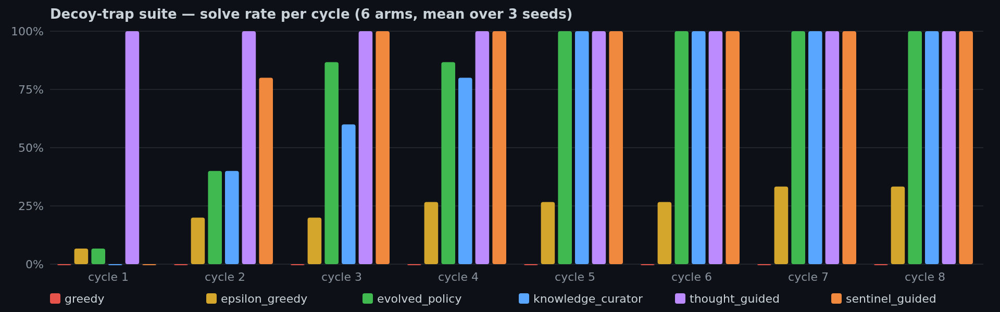

# Benchmarks and evaluation

## goose × TravelPlanner (public, externally scored)

This is the **only benchmark** in this project — everything else below the
heading line is machinery self-check. A real agent (goose v1.53) plans real
itineraries against the official **TravelPlanner** offline database
(`osunlp/TravelPlanner`) over a stdlib MCP sandbox, scored by the benchmark's
*own* commonsense and hard-constraint evaluators (nothing in the scoring path
is ours), on the model `Qwen3.8-Flash-Next` served by vLLM. Same endpoint and
model across every study in this repo and the paper.

Frozen protocol: iterations only on `train.csv` (45 tasks); one preregistered
eval pass on official validation rows 102–181 (79 tasks, 60 hard),
configuration unchanged from the dev split; official test split never
touched. Arms interleaved task-by-task per pass (paired, McNemar-ready).
The gate arm is *choice removal*, not persuasion: past 36 of 45 tool calls
the sandbox refuses to serve (all text channels off). The gate alone is the
entire arm — no policy, recipe or lesson text enters these episodes — so the
delta measures the fixed call-cutoff intervention itself, not learned
content; the learned machinery is validated separately on the scripted
suites above.

| split | arm | delivered plans | commonsense pass | hard pass | final pass |
|---|---|---|---|---|---|
| train (45) | cold | 15/45 (33%) | 4 | 3 | 6.7% |
| train (45) | gate | 41/45 (91%) | 18 | 9 | 20.0% |
| **eval (79)** | cold | 18/79 (23%) | 12 | 6 | 7.6% |
| **eval (79)** | gate | **74/79 (94%)** | 40 | 17 | **21.5%** |

McNemar on paired delivery: eval 56↔0 discordant, p=1.4e-17 (train 28↔2,
p=4.3e-7). 95% Wilson intervals on the eval split: delivery 22.8%
[14.9, 33.2] → 93.7% [86.0, 97.3]; final pass 7.6% [3.5, 15.6] → 21.5%
[13.9, 31.8]. 79 eval tasks, one model, one benchmark: the delivery
contrast is the decisive effect; the final-pass point estimates carry wide
intervals and no cross-model replication yet.


Why it works: **every single undelivered cold episode (91/91 across both
splits) died pinned at the harness call cap with the sandbox data already
in hand** — the binding failure under budget pressure is *termination*, not
error recovery, and three text-in-context channels measured earlier
(pull tool, Stop-hook note, budget nudge) converted zero of those episodes.
Removing the option to keep exploring is the only lever that moved delivery.
Honest caveats: the *choice* of gate over persuasion was made knowing
results on the earlier 101-task validation pool (selection era, archived —
the eval pass is a preregistered confirmation, not a first exposure); the
gate's 5 residual eval failures are episodes that called through the
refusals to the cap anyway. Everything behind these numbers is in this
directory: `benchmarks/travelplanner/` — the sandbox MCP server, the
episode runner, the official-evaluator wrapper, the exact split CSVs and
the raw per-episode records. `python3 score.py results/submissions/…`
reproduces the table above to the task from the committed records; the
directory README documents prerequisites and the one-command rerun. The
figure re-renders from `fixtures/tp_v3_summary.json` via
`paper/make_figures.py`. Paper §Evaluation.

---

## Machinery self-checks (deterministic, key-free)

Not benchmarks — behavioural regression contracts: a scripted solver makes
the model arm a constant, so every delta is attributable to the library's
gates, sandboxes, promotion and retrieval logic. They exist so a broken
mechanism fails CI instead of silently mutating a published number, and they
re-run from a fresh clone in seconds.

### `bench` — the dreaming loop against a cold baseline

| arm | solves | API calls | calls / task·cycle | dream its |
|---|---|---|---|---|
| cold_baseline (fresh memory each cycle) | 50 | 150 | 3.0 | 0 |
| dream_rsi_loop (policies + recipes + dreaming) | 50 | 71 | 1.42 | 3000 |

**53% fewer API calls at equal solve quality** (re-measured on this commit:
identical to the published table).

```bash
python -m open_dream_rsi bench --cycles 10 --markdown
```

### `bench-policy` — decoy traps (exploration contracts)

Solve-rate self-checks saturate on easy suites and cannot tell good
exploration from luck, so `bench-policy` hides each fix behind a
*low-scoring* branch (passes 1/3 tests) past a *plausible decoy* (passes 2/3
forever). A score-greedy loop locks onto the decoy and starves; escaping
requires structural exploration. Six arms, one scripted solver, one budget:

| arm | solves | solve rate | API calls | calls / solve | policy calls | curator calls |
|---|---|---|---|---|---|---|
| greedy | 0/120 | 0% | 480 | ∞ | 0 | 0 |
| epsilon_greedy | 29/120 | 24% | 405 | 13.97 | 0 | 0 |
| **evolved_policy** | **93/120** | **78%** | **249** | **2.68** | 26 | 0 |
| **knowledge_curator** | **87/120** | **72%** | 330 | 3.79 | 0 | 27 |
| **thought_guided** | **120/120** | **100%** | **164** | **1.37** | 0 | 0 |
| **sentinel_guided** | **102/120** | **85%** | 219 | 2.15 | 15 | 0 |

```bash
python -m open_dream_rsi bench-policy --cycles 8 --format md
```

The per-arm explanations and ablations (ledger-only, engine-off), the pinned
invariants, and the `gate-replay` promotion-rule replayer:
**[docs/self-checks.md](self-checks.md)**.



---

## What the loop learned about memory (honest results)

The knowledge curator distils verifier failures into short, validated,
deduplicated **lessons** — pure text, never executed. Live-model replay,
however, proved that fresh lessons are *hazardous by default*:

- Structurally perfect lessons (passed every schema/caps gate) dropped
  solve-rate **18/20 → 6/20** on a greedy decoder: "keep checking"-style
  advice turns greedy decoding into an over-exploration loop.
- The same facts rewritten as **declarative background** (no imperative
  verbs, explicit stop clause): 18/20 — indistinguishable from cold
  (McNemar p=1.0). The hazard is imperative mood, not content.
- Seven further published injection strategies (abstract workflows,
  exemplars, evidence certificates, reactive-on-error notes,
  end-of-prompt position) scored **zero** paired gains against a
  contemporaneous cold baseline; moving safe text to the end of the prompt
  was actively harmful (11/20, p=0.008 — recency makes the model *act* on
  facts that were inert mid-prompt).

The shipped design encodes all of that: lessons are `staging` candidates
that must pass a paired-replay gate (net ≥ 1, **zero** solve→fail
regressions, explicit stop clause) before any prompt sees them; proposal
prompts frame the KB as declarative background; and a per-category
**headroom verdict** (skip curation when recent solve-rate ≥ 0.7 *and*
calls/solve ≤ 5) spends zero curator/gate calls where the cold baseline
already wins. Guidance pays a perturbation tax — the loop only pays it
where there is measurable headroom to spend it against.

### Verdicts must be replayable (why lessons anchor on tool calls)

Tool results are the only evidence class with cheap, objective ground
truth — exit code, timeout, empty payload, retrieved content — so the
paired-replay gate can re-execute the same moment and decide. Prose
quality ("was this plan good?") has no such oracle: an LLM judge cannot
be re-run into a decision, only re-sampled into noise — and that noise
is measured, not hypothetical. Trusting freshly distilled lessons
*without* replay dropped a greedy solver from 18/20 to 6/20, and the one
noise-promoted lesson that ever reached production (an anodyne "answer
more directly") won its coin flip precisely because it rarely hurt —
hence the confirmed-strict-win promotion. The loop therefore learns
where truth is cheap and treats everything else as unevidenced material,
not knowledge. The user's own in-session corrections are a second evidence
class, fed through the same staging → replay-gate discipline (see
[sessions.md](sessions.md)).
